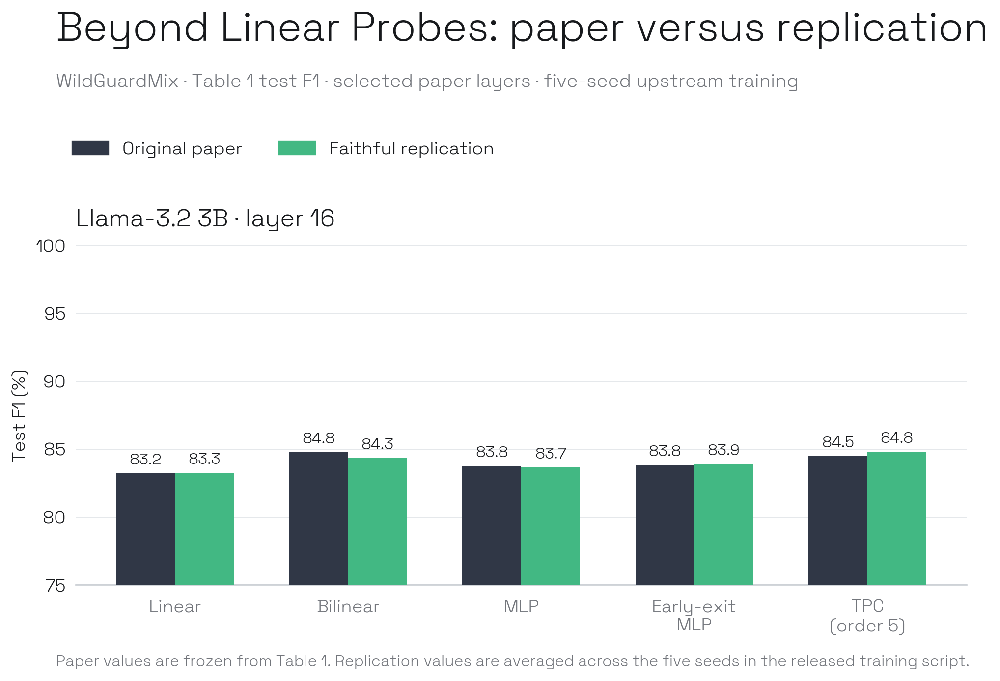

# Beyond Linear Probes

ICLR 2026 paper proposing Truncated Polynomial Classifiers (TPCs), a probe
architecture that extends a linear residual-stream probe with progressively
evaluated higher-order neuron interactions. The headline claim is that a
single fifth-order, symmetric-CP polynomial can trade inference compute for
safety-monitoring F1 and can run as an adaptive cascade.

## Baseline target

Reproduce Figure 2 and Table 1 on WildGuardMix for Gemma-3-27B-it,
Qwen3-30B-A3B-Base, GPT-OSS-20B, and Llama-3.2-3B. The paper uses mean-pooled
residual-stream activations, fifth-order TPCs with rank 64, matched linear,
bilinear, MLP, and early-exit MLP baselines, five seeds, and the released
validation-selected layers. Paper values are frozen in
`data/results/beyond-linear-probes/baseline_targets.csv`.

## Release audit

| Item | State |
| :--- | :--- |
| Upstream code | Released at commit `e50d3c4f1bd01c90c08e571c1500d8b4aa62bd13` |
| WildGuardMix and BeaverTails | Public datasets referenced by the scripts |
| Extraction and monitor training scripts | Released and executed unchanged by the wrapper |
| Dependency lockfile | Not released |
| Model revisions | Not pinned |
| Activation cache | Not released; regenerated from the public datasets |
| Qwen3 WildGuard filenames | Extractor and monitor disagree (`wildguard_train/test` vs `train/test`) |
| Author hardware | NVIDIA A100 40GB |
| Replication extraction runtime | Eager PyTorch execution after the released `torch.compile` path stalled; source and activation operations were unchanged |
| Retained baseline metrics | Released outputs contain aggregate F1; extension sidecars will add thresholds, confusion matrices, and row-level predictions |

## Baseline replication

We reproduced the selected Llama-3.2-3B layer-16 WildGuardMix condition with
the released extraction and training scripts. The comparison uses the paper's
five seeds, validation split, hyperparameter sweeps, progressive fifth-order
rank-64 TPC, and matched probe baselines.

| Probe | Paper test F1 | Replication test F1 | Delta |
| :--- | ---: | ---: | ---: |
| Linear | 83.24% | 83.26% | +0.02 pp |
| Bilinear | 84.78% | 84.35% | -0.43 pp |
| MLP | 83.77% | 83.66% | -0.11 pp |
| Early-exit MLP | 83.84% | 83.92% | +0.08 pp |
| TPC, order 5 | 84.48% | 84.81% | +0.33 pp |

The mean absolute test difference is 0.20 percentage points and the largest
difference is 0.43 points. We therefore classify the selected baseline
replication as **successful**. This verdict covers the Llama layer-16 condition,
not every model and layer reported in Table 1.

The plotting-ready validation and test results are stored in
`data/results/beyond-linear-probes/baseline_replication.csv`; hashes and raw
five-seed outputs are retained under `artifacts/beyond-linear-probes`.

## Extension

The next experiment tests method generalization: retrain the same five probe
architectures and paper settings on held-out model families, then compare their
relative F1 and compute–performance curves with the replicated Llama baseline.
This is cross-model evaluation of the method, not direct transport of one
frozen probe between incompatible hidden-state spaces. Extension sidecars will
also retain thresholds, confusion matrices, and row-level predictions.
