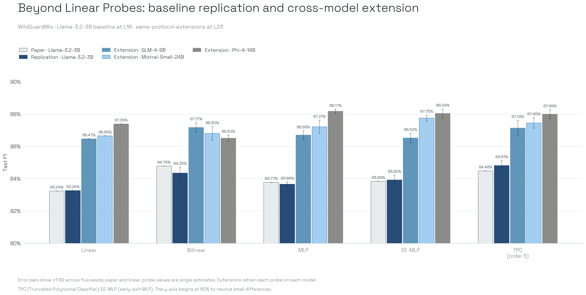

# Beyond Linear Probes

ICLR 2026 paper proposing Truncated Polynomial Classifiers (TPCs), a probe
architecture that extends a linear residual-stream probe with progressively
evaluated higher-order neuron interactions. The headline claim is that a
single fifth-order, symmetric-CP polynomial can trade inference compute for
safety-monitoring F1 and can run as an adaptive cascade.

## Baseline Target

Reproduce Figure 2 and Table 1 on WildGuardMix for Gemma-3-27B-it,
Qwen3-30B-A3B-Base, GPT-OSS-20B, and Llama-3.2-3B. The paper uses mean-pooled
residual-stream activations, fifth-order TPCs with rank 64, matched linear,
bilinear, MLP, and early-exit MLP baselines, five seeds, and the released
validation-selected layers.

## Release Audit

| Item | State |
| :--- | :--- |
| Upstream code | Released at commit `e50d3c4f1bd01c90c08e571c1500d8b4aa62bd13` |
| WildGuardMix and BeaverTails | Public datasets referenced by the scripts |
| Extraction and monitor training scripts | Released and executed unchanged by the wrapper |
| Dependency lockfile | Not released |
| Model revisions | Not pinned |
| Activation cache | Not released; regenerated from the public datasets |
| Qwen3 WildGuard filenames | Extractor and monitor disagree (`wildguard_train/test` vs `train/test`) |
| Author hardware | NVIDIA A100 40GB |
| Replication extraction runtime | Eager PyTorch execution after the released `torch.compile` path stalled; source and activation operations were unchanged |
| Retained baseline metrics | Released outputs contain aggregate F1; this summary does not establish complete threshold or row-level coverage |

## Baseline Replication

We reproduced the selected Llama-3.2-3B layer-16 WildGuardMix condition with
the released extraction and training scripts. The comparison uses the paper's
validation split, hyperparameter sweeps, progressive fifth-order rank-64 TPC
and matched probe families. Nonlinear results aggregate five fits; the retained
linear result comes from one fit. This imbalance limits comparisons of fitting
variability and does not support a significance claim.

| Probe | Paper test F1 | Replication test F1 | Delta |
| :--- | ---: | ---: | ---: |
| Linear | 83.24% | 83.26% | +0.02 pp |
| Bilinear | 84.78% | 84.35% | -0.43 pp |
| MLP | 83.77% | 83.66% | -0.11 pp |
| Early-exit MLP | 83.84% | 83.92% | +0.08 pp |
| TPC, order 5 | 84.48% | 84.81% | +0.33 pp |

The mean absolute test difference is 0.20 percentage points and the largest
difference is 0.43 points. We therefore classify the selected baseline
replication as **successful**. This verdict covers the Llama layer-16 condition,
not every model and layer reported in Table 1.

## Extension

We retrained the same five probe architectures on WildGuardMix activations from
GLM-4-9B-0414, Mistral-Small-24B-Instruct-2501, and Phi-4-14B. This evaluates
cross-model generalization of the training method, not transfer of one frozen
probe between incompatible hidden-state spaces.

| Model | Mean F1 | Best probe | TPC gain over linear |
| :--- | ---: | :--- | ---: |
| Llama-3.2-3B replication | 84.00% | TPC, 84.81% | +1.55 pp |
| GLM-4-9B-0414 | 86.80% | Bilinear, 87.17% | +0.66 pp |
| Mistral-Small-24B-Instruct-2501 | 87.17% | Early-exit MLP, 87.75% | +0.80 pp |
| Phi-4-14B | 87.62% | MLP, 88.17% | +0.60 pp |

All three extension models exceeded the replicated Llama baseline in absolute
F1, and TPC outperformed the linear probe on every model. However, TPC was not
consistently the best architecture: bilinear, early-exit MLP, and MLP probes
ranked first on GLM, Mistral, and Phi respectively, with small numerical differences and unequal fitting repetitions. We therefore classify the extension as a
**generalization success**, while the stronger claim of universal TPC dominance
is not supported. The comparison covers one dataset and one selected layer per
extension model; larger extension models may also contribute to their higher
absolute scores.
