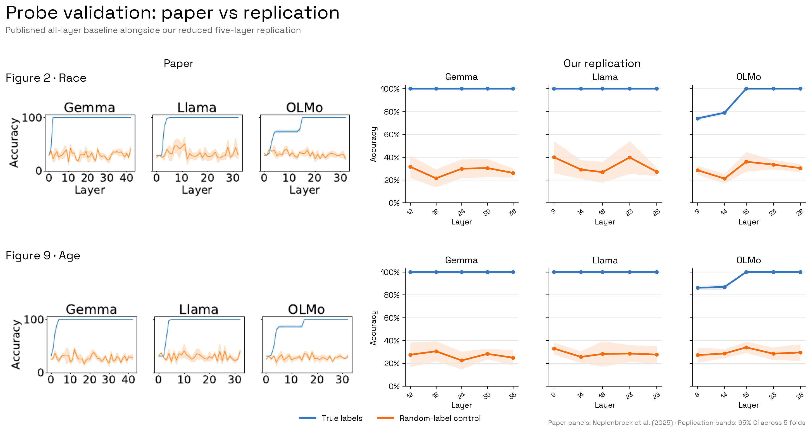
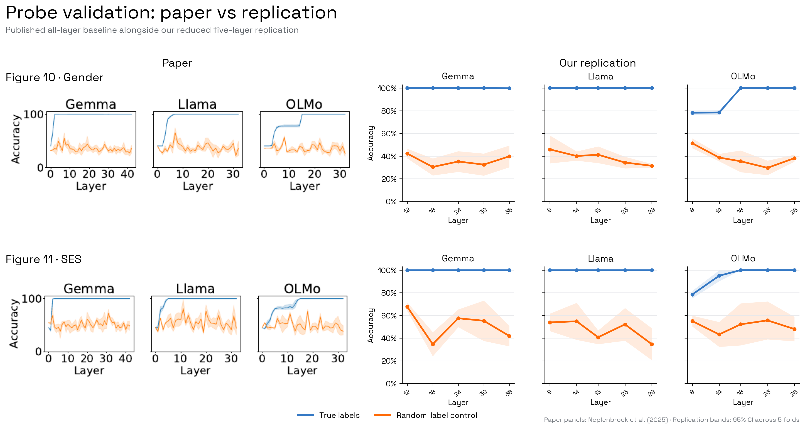
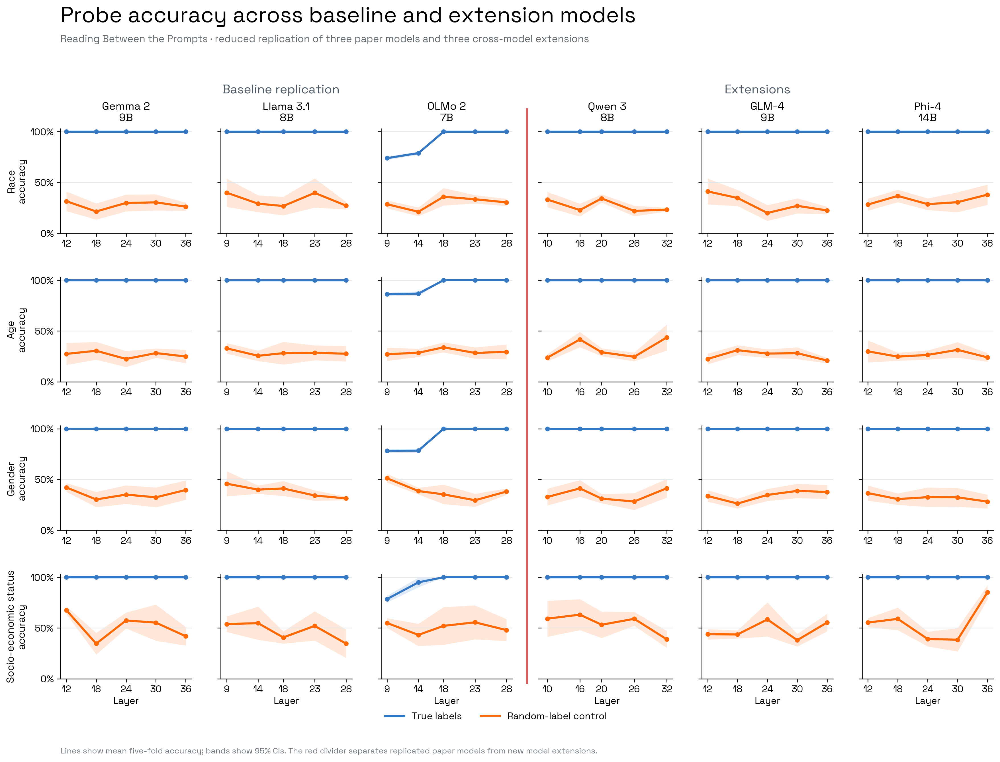

# Reading Between the Prompts

The paper studies whether instruction-tuned LLMs build latent demographic user
representations from explicit identity statements or stereotypical cues during
multi-turn conversations. Multiclass linear probes decode age, gender, race,
and socio-economic status at every layer; probe weights are also used for
activation steering.

## Baseline target

Reproduce the probe validation curves in Figures 2 and 9–11, then the main
stereotype-driven probe result in Figure 4 and the explicit-conflict result in
Figure 5 using the released 250-conversation conditions. Core probe targets are frozen in
`data/results/implicit-personalization/core_claim_targets.csv`.

The first run is compute-reduced to five interior layers per model: Gemma
`12, 18, 24, 30, 36`; Llama and OLMo `9, 14, 18, 23, 28`. It retains the
released representation extraction, logistic probe, random-label control, and
five-fold evaluation. Consequently, it tests the reported layerwise trend but
is not an exact point-for-point reproduction of Figures 2 and 9–11.

## Release audit

| Item | State |
| :--- | :--- |
| Probe, evaluation, mitigation, and plotting code | Released |
| Conversation templates and stereotype inventory | Released |
| Exact `conversations_250.json` | Released |
| Model-generated assistant turns | Regenerated on-policy with greedy decoding |
| Model revisions | Not pinned |
| Saved probes and paper result files | Not released |
| Randomness | NumPy and logistic regression use 42; Python set ordering is not fixed |
| Environment | Key versions pinned, but the released requirements contain local Conda paths |

## Baseline result

| Model | Attribute | Layers | Paper accuracy (%) | Replication accuracy (%) |
| :--- | :--- | :--- | :--- | :--- |
| Gemma | Race, age, SES | 12, 18, 24, 30, 36 | 100, 100, 100, 100, 100 | 100, 100, 100, 100, 100 |
| Gemma | Gender | 12, 18, 24, 30, 36 | 100, 100, 100, 100, 100 | 100, 100, 100, 100, 99.9 |
| Llama | All four attributes | 9, 14, 18, 23, 28 | 100, 100, 100, 100, 100 | 100, 100, 100, 100, 100 |
| OLMo | Race | 9, 14, 18, 23, 28 | ≈74.1, 78.2, 100, 100, 100 | 73.9, 78.9, 100, 100, 100 |
| OLMo | Age | 9, 14, 18, 23, 28 | ≈85.9, 86.5, 100, 100, 100 | 86.2, 86.8, 100, 100, 100 |
| OLMo | Gender | 9, 14, 18, 23, 28 | ≈77.6, 78.2, 100, 100, 100 | 78.2, 78.5, 100, 100, 100 |
| OLMo | SES | 9, 14, 18, 23, 28 | ≈82.4, 96.5, 100, 100, 100 | 78.5, 95.0, 100, 100, 100 |

Paper values are digitized approximations because the underlying result arrays
were not released. Random-label controls differ by approximately 4.8 percentage
points on average, but preserve the reported separation from the true probes.

## Baseline verdict

**Successful reduced replication.** The selected-layer true-probe curves recover
the paper's near-perfect Gemma and Llama decoding and OLMo's delayed rise to
100%. This validates the probe-training baseline required for extensions, but
is not an exact all-layer reproduction.

Plotting-ready results are in
`data/results/implicit-personalization/probe_validation_baseline.csv`.

## Cross-model extension

The same released representation extraction and five-fold logistic-probe
training were applied to five selected interior layers of three additional
instruction-tuned models.

| Model | Parameters | Layers | True-probe accuracy | Random-control mean |
| :--- | ---: | :--- | ---: | ---: |
| Qwen3-8B | 8B | 10, 16, 20, 26, 32 | 100.0% | 37.3% |
| GLM-4-9B-0414 | 9B | 12, 18, 24, 30, 36 | 100.0% | 34.3% |
| Phi-4 | 14B | 12, 18, 24, 30, 36 | 100.0% | 36.8% |

The true probes achieved 100% mean accuracy for race, age, gender, and
socio-economic status at every selected layer in all three models. Random-label
controls remained substantially lower, although Phi-4's socio-economic-status
control was unusually high at layer 36 (85.1%).

## Final verdict

**Successful reduced replication and extension.** The selected-layer baseline
recovered the paper's near-perfect Gemma and Llama curves and OLMo's delayed
rise to 100%. Qwen3-8B, GLM-4-9B, and Phi-4 then reached 100% true-probe
accuracy for every tested attribute and layer, while their aggregate
random-label controls remained at 34.3–37.3%.

The probe-validation claim therefore generalizes across the six tested model
families in this controlled setting. The result establishes cross-model linear
separability of explicitly introduced demographic identity; it does not by
itself establish that stereotype-driven personalization or activation steering
generalizes to the extension models.

Plotting-ready extension results are in
`data/results/implicit-personalization/cross_model_extension.csv`.
