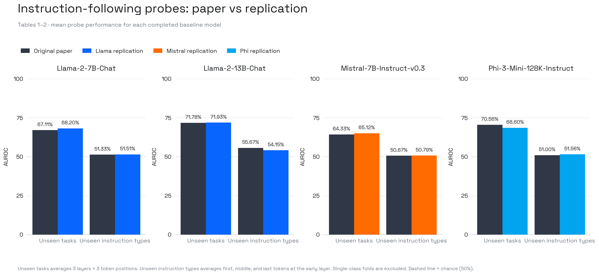
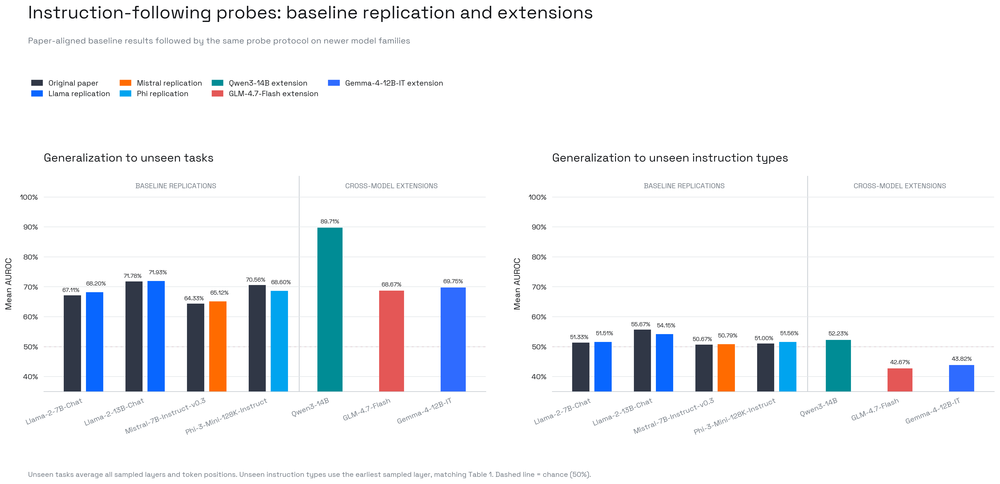
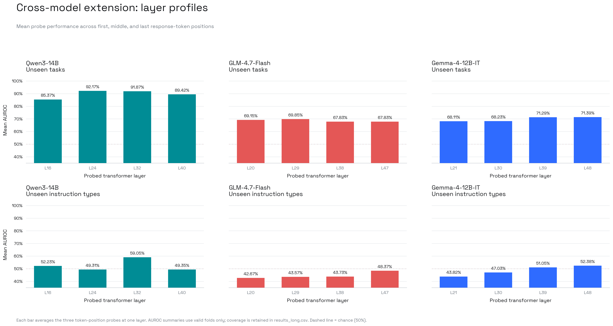

# Do LLMs “Know” Internally When They Follow Instructions?

[Paper](https://arxiv.org/abs/2410.14516) · ICLR 2025 · [Released code](https://github.com/apple/ml-internal-llms-instruction-following)

See also: [Generalization analysis](generalization.md) — taxonomy of why
instruction-type transfer fails across model families.

This ICLR 2025 paper tests whether an instruction-tuned model's hidden state
predicts whether its eventual answer will follow an instruction. It trains a
bias-free linear sigmoid probe on first-, middle-, and last-response-token
activations. The paper finds strong generalization to unseen tasks within known
instruction types, but near-chance transfer to unseen instruction types. We
reproduced the released-model probe baseline closely and extended the same
protocol to Qwen, GLM, and Gemma. Unseen-task detection transfers, but
instruction-type transfer remains unstable and becomes partly undefined when a
model follows or fails an entire held-out instruction type.

## Verdict

**The paper's main qualitative claim and aggregate baseline reproduce, but the
exact full-table replication is partial.** Llama-2 and Mistral have 1.34–2.01
percentage-point cellwise MAE for unseen-task AUROC. Phi-3's aggregate differs
by only 1.95 points, but its layer/token profile has 6.68-point MAE, including
large opposing shifts that cancel in the aggregate. Unseen-instruction-type
aggregates remain close to the paper for all four models. The extension supports
the central distinction: probes transfer across unseen tasks, while
instruction-type generalization is not robust across model families, layers, or
the on-policy label distribution.

This report covers the probe results in Tables 1–2. The Table 4
representation-engineering intervention is outside the completed scope.

## Method

The released IFEval-simple artifact contains 510 GPT-4-generated prompts across
five instruction types, with 102 tasks per type. Each evaluated model greedily
generates its own answers, so responses and success labels are on-policy for that
model. Google's deterministic loose IFEval evaluator supplies the binary labels.

For every model and sampled layer, we train the paper's bias-free linear probe
for 1,000 epochs with AdamW (`lr=0.001`, `weight_decay=0.1`). Unseen-task results
use a 70/30 task split over five seeds. Unseen-instruction-type results use five
leave-one-type-out folds. AUROC is the paper-comparison metric; extension runs
also retain the decision threshold, confusion matrix, accuracy, balanced
accuracy, precision, recall, specificity, FPR, FNR, F1, and row-level scores.
The extension deliberately preserves the release's hard-coded Llama-2 prompt
template for every model. This keeps the probing protocol fixed but may also
contribute to cross-family differences.

## Baseline replication

| Model | Unseen tasks: paper | Replication | MAE | Unseen types: paper | Replication | MAE |
| :--- | ---: | ---: | ---: | ---: | ---: | ---: |
| Llama-2-7B-Chat | 67.11% | 68.20% | 2.01 pp | 51.33% | 51.51% | 0.61 pp |
| Llama-2-13B-Chat | 71.78% | 71.93% | 1.34 pp | 55.67% | 54.15% | 1.52 pp |
| Mistral-7B-Instruct-v0.3 | 64.33% | 65.12% | 1.88 pp | 50.67% | 50.79% | 0.98 pp |
| Phi-3-Mini-128K-Instruct | 70.56% | 68.60% | 6.68 pp | 51.00% | 51.56% | 0.80 pp |

Unseen-task means average all three reported layers and token positions from
Table 2. Unseen-type means use the early layer and three token positions from
Table 1. MAE is calculated over the underlying paper-aligned cells, not from the
two displayed aggregate means. Phi-3's frequency block is all positive in our
on-policy responses, so its unseen-type AUROC averages four valid folds rather
than five.

## Cross-model extension

| Model | Layers | Answer success | Unseen tasks | Best task cell | Unseen types, early layer | Best type cell | Valid type folds |
| :--- | :--- | ---: | ---: | :--- | ---: | :--- | :--- |
| Qwen3-14B | 16, 24, 32, 40 | 75.29% | 89.71% | 96.86% · L16 first | 52.23% | 71.60% · L32 first | 3/5 |
| GLM-4.7-Flash | 20, 29, 38, 47 | 71.57% | 68.67% | 81.33% · L29 first | 42.67% | 64.78% · L38 last | 5/5 |
| Gemma-4-12B-IT | 21, 30, 39, 48 | 27.06% | 69.75% | 77.38% · L30 first | 43.82% | 54.23% · L48 last | 4/5 |

Unseen-task AUROC averages every sampled layer and token position. The
unseen-type headline uses the earliest sampled layer to match Table 1; the best
cell scans all sampled layers and token positions. Qwen's keyword-exclusion and
number-placeholder blocks are all positive, while Gemma's end-checker block is
all negative. Their AUROC is therefore undefined for those held-out folds. This
is not missing compute: it is model-dependent label collapse in the generated
on-policy answers, and the tables retain the resulting coverage.

## Generalization failure analysis

The failure is concentrated in unseen instruction types, not unseen tasks.
Qwen, GLM, and Gemma retain 0.8971, 0.6867, and 0.6975 mean unseen-task AUROC,
respectively. Their paper-aligned early-layer unseen-type results fall to
0.5223, 0.4267, and 0.4382. The original baselines were already close to chance
on this test, so the extension does not show a new universal failure. It shows
that the paper's main limitation persists across model families and becomes
less stable.

The clearest observed mechanism is model-dependent on-policy label shift. Each
model generates its own answers and therefore changes both the activations and
the IFEval success distribution. Qwen produces two all-positive instruction
types, Gemma produces one all-negative type, and those held-out AUROCs become
undefined. The probe therefore appears to learn instruction-specific behavioral
correlates rather than a model-invariant instruction-following direction. Layer
sensitivity is a second factor: later GLM and Gemma cells outperform the
paper-aligned early layer. The fixed Llama-2 prompt template may also contribute,
but this remains a hypothesis. Fixed-response and native-template ablations are
needed to separate architecture effects from policy-induced data shift.

## Reproducibility boundaries

| Item | Paper or release | Replication decision |
| :--- | :--- | :--- |
| Dataset size | Paper states 500; release contains 510 | Retain all 510 because the excluded rows are unidentified |
| Task split | Paper states 70/30; notebook uses 80/20 | Follow the paper's 70/30 split |
| Seeds | Five runs; exact seeds absent | Record replacement seeds 0–4 |
| Model and evaluator revisions | Not pinned | Pin both source trees and every model snapshot |
| Prompt template | Hard-coded Llama-2 format for every model | Preserve it for baselines and extensions |
| IFEval schema | 102 rows store `kwargs` as a dictionary | Apply a shape-only list wrapper required by the official evaluator |
| Released artifacts | No responses, labels, activations, probes, or results | Regenerate them through the pinned source-preserving wrapper |

The upstream Apple checkout remains unchanged at `7ed7558`. The wrapper fixes
only execution boundaries, calls the released activation script, and uses a
pinned Google IFEval evaluator.

## Artifacts

- Paper-aligned baseline table: `data/results/internal-instruction-following/baseline_comparison.csv`
- Plotting-ready AUROC table: `data/results/internal-instruction-following/results_long.csv`
- Full available diagnostics: `data/results/internal-instruction-following/metrics_long.csv`
- Per-run results: `data/results/internal-instruction-following/run_metrics.csv`; legacy baseline rows explicitly mark unavailable confusion matrices
- Row-level scores, predictions, and directions from the diagnostic runs: public Hugging Face artifact bucket
