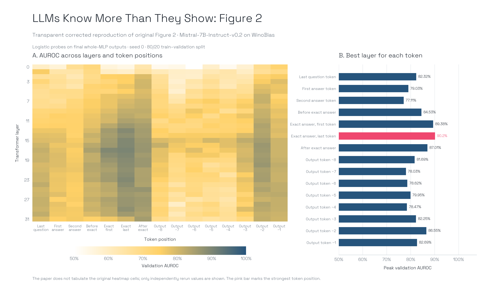
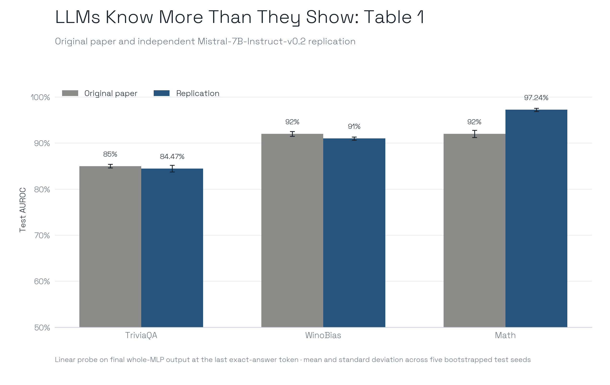
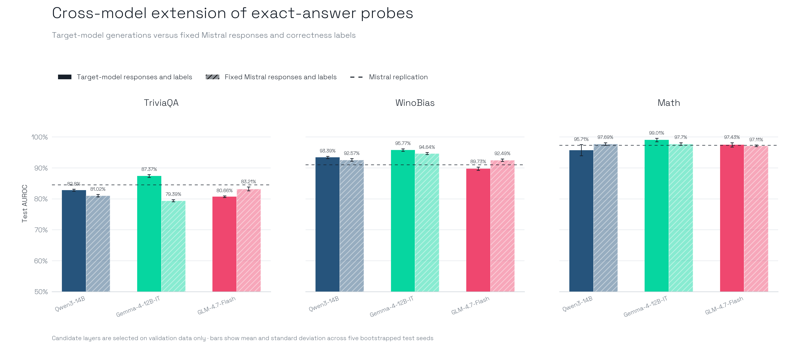

# LLMs Know More Than They Show

[Paper](https://proceedings.iclr.cc/paper_files/paper/2025/file/a712d461e57201efe35d429a6f1731c1-Paper-Conference.pdf) · ICLR 2025 · [Released code](https://github.com/technion-cs-nlp/LLMsKnow)

The paper asks whether a model's hidden states reveal when its own generated answer is wrong. It fits binary logistic-regression probes to token-level MLP activations. The main result is that activations at the exact answer token predict correctness substantially better than activations at the question boundary or response end. Cross-task transfer is weaker: after comparison with output-logit baselines, useful transfer is mainly confined to tasks requiring similar skills.

## Evaluation Protocol

| Item | Specification |
| :--- | :--- |
| Models | Mistral-7B, Mistral-7B-Instruct-v0.2, Llama-3-8B, and Llama-3-8B-Instruct |
| Data | TriviaQA, HotpotQA with and without context, Movies, WinoGrande, WinoBias, MNLI, Math, IMDB, and Natural Questions with context |
| Data regime | Fixed benchmark prompts, but model-generated answers and model-dependent correctness labels; the probe examples are on-policy |
| Probe | Scikit-learn logistic regression with default L2 regularization and LBFGS |
| Activation | Final MLP output at a selected layer and token, according to the paper |
| Split | 80% training and 20% validation; independent test examples are bootstrap-resampled |
| Seeds | Not stated in the paper; released examples use 0, 5, 26, 42, and 63 |
| Metric | AUROC; the released probe code treats the error class as positive |
| Generation | Greedy, unrestricted free-text answers; refusals are excluded |
| Compute | Not reported |

Each model generates its own responses, so changing the model also changes the evaluated response and label distribution. Correctness is usually determined with gold-answer heuristics. Natural Questions with context uses an instruction-model judge. For open-ended questions, exact answers are first matched against gold aliases; otherwise Mistral-7B-Instruct extracts a short answer substring. Invalid extractions and `NO ANSWER` cases are removed.

## Primary Targets

**Figure 2** sweeps all 32 layers and answer-token positions for Mistral-7B-Instruct on TriviaQA, WinoBias, and Math, using 1,000 examples and seed 0. The expected pattern is strongest performance at exact-answer tokens in middle-to-late layers. Exact heatmap cells are not tabulated in the paper.

**Table 1** compares probes at four token positions with logit and P(True) baselines. The exact-answer probe reaches the following AUROCs:

| Model | TriviaQA | WinoBias | Math |
| :--- | ---: | ---: | ---: |
| Mistral-7B-Instruct | 0.850 ± 0.004 | 0.920 ± 0.005 | 0.920 ± 0.008 |
| Llama-3-8B-Instruct | 0.830 ± 0.002 | 0.930 ± 0.004 | 0.950 ± 0.027 |

**Figure 3** evaluates source-to-target transfer across all ten datasets. The target token and layer are first selected with target validation labels, so the experiment transfers probe weights but not a target-label-free site-selection procedure.

## Release Audit

The repository is pinned at `bee3ec5787e72f09ec1603e50e9b64c41fbc6f23`. It provides the main scripts and several source datasets, but no generated answers, correctness-labelled outputs, token tensors, logits, probe checkpoints, selected layers, W&B run IDs, result tables, or Figure 2 data. TriviaQA must be downloaded separately, and live Hugging Face datasets and model snapshots are not revision-pinned.

The unchanged release cannot reproduce Figure 2 or Table 1. Test dataset names are implemented but rejected by the answer-generation CLI. Probe and logit evaluation hard-code Mistral test-answer files even for Llama. P(True) imports a missing module. The README's Table 1 probe command includes unsupported arguments. Local Figure 2 CSVs and images are deleted after W&B upload. The paper also specifies final MLP output, while its released Figure 2 command captures the input to the MLP down-projection. An unresolved EOS handling issue can make final token positions refer to padding-like post-EOS continuation.

Appendix A.4 specifies an 80/20 train-validation split for each seed, but the released `probe.py` caps its auxiliary validation subset at 1,000 examples when all training data are requested. This discrepancy does not change the reported held-out Table 1 test AUROC: the released implementation fits that final classifier on all valid training examples and only bootstraps the independent test set. Our local runtime follows the paper's 80/20 split for validation and records this paper-code mismatch explicitly.

## Corrected Figure 2 Reproduction

We completed the Mistral-7B-Instruct-v0.2 WinoBias panel with the source pinned at `bee3ec5787e72f09ec1603e50e9b64c41fbc6f23` and the model pinned at `63a8b081895390a26e140280378bc85ec8bce07a`. The run used seed 0, 1,000 examples, all 32 layers, all 15 token positions, the final whole-MLP output, and corrected EOS handling. It produced 480 layer–token metric rows and 96,000 row-level predictions.

The maximum occurred at the last exact-answer token in layer 17, recovering the paper's qualitative localization of correctness information at exact-answer tokens in middle-to-late layers.

| Metric at the peak | Result |
| :--- | ---: |
| AUROC | 90.20% |
| AUPRC | 72.87% |
| Balanced accuracy | 71.66% |
| TN / FP / FN / TP | 145 / 7 / 25 / 23 |
| TPR at 1% FPR | 18.75% |
| TPR at 5% FPR | 47.92% |

For context, Table 1 reports `0.920 ± 0.005` AUROC for the Mistral WinoBias exact-answer probe. This is not an exact numerical target for the present run: the paper does not tabulate the Figure 2 heatmap cells, and Table 1 uses a different evaluation and aggregation protocol. We therefore treat this result as a **qualitative recovery of the Figure 2 localization pattern**, not a complete replication of the paper's baseline.

## Table 1 Baseline Replication

We independently reran the Mistral-7B-Instruct-v0.2 exact-answer probe on all three primary Table 1 datasets. Layers were selected using validation AUROC before the independent test evaluation. The selected layers were 11 for TriviaQA, 17 for WinoBias, and 25 for Math.

| Dataset | Paper AUROC | Replication AUROC | Difference |
| :--- | ---: | ---: | ---: |
| TriviaQA | 85.00 ± 0.40% | 84.47 ± 0.72% | −0.53 pp |
| WinoBias | 92.00 ± 0.50% | 91.00 ± 0.34% | −1.00 pp |
| Math | 92.00 ± 0.80% | 97.24 ± 0.33% | +5.24 pp |

TriviaQA and WinoBias remained close to the reported values, while Math was materially higher. The rerun therefore recovers the paper's central baseline result—that correctness is strongly linearly decodable at the exact-answer token—but does not reproduce every reported magnitude. The five test-bootstrap replicates quantify resampling variability, not
variation across five independent probe fits. Recorded metrics include AUPRC, calibration, low-FPR detection, confusion counts, and row-level predictions.

## Extension Protocol

The extension keeps the three primary Table 1 datasets, the last exact-answer token, final whole-MLP activations, logistic-regression probe and five test-bootstrap seeds fixed. It evaluates Qwen3-14B, Gemma-4-12B-IT, and GLM-4.7-Flash at five well-spaced candidate layers. Layer selection uses validation AUROC only; no target-test labels are used to choose a site.

Each target model is evaluated twice. The **on-policy** condition uses that model's own generated responses and resulting correctness labels. The **fixed-response** condition teacher-forces the same Mistral responses and labels through every target model. This separates a change in internal representation from a simultaneous change in the response-and-label distribution. In addition to AUROC, every run retains AUPRC, calibration errors, balanced accuracy, precision, recall, F1, confusion counts, thresholds, low-FPR TPR, and row-level predictions.

## Cross-model Extension Results

All three extensions completed across the two evaluation regimes, three datasets, five candidate layers, and five test-bootstrap seeds. Values below are test AUROC; the validation-selected layer is shown in parentheses.

| Model | Evaluation responses and labels | TriviaQA | WinoBias | Math |
| :--- | :--- | ---: | ---: | ---: |
| Mistral-7B-Instruct-v0.2 | Own | 84.47% (L11) | 91.00% (L17) | 97.24% (L25) |
| Qwen3-14B | Own | 82.80% (L20) | 93.39% (L26) | 95.71% (L38) |
| Qwen3-14B | Fixed Mistral | 81.02% (L26) | 92.57% (L26) | 97.69% (L32) |
| Gemma-4-12B-IT | Own | 87.37% (L24) | 95.77% (L31) | 99.01% (L31) |
| Gemma-4-12B-IT | Fixed Mistral | 79.39% (L46) | 94.64% (L31) | 97.70% (L31) |
| GLM-4.7-Flash | Own | 80.66% (L45) | 89.73% (L31) | 97.43% (L31) |
| GLM-4.7-Flash | Fixed Mistral | 83.21% (L24) | 92.49% (L24) | 97.11% (L24) |

The exact-answer probe remained strongly predictive across every tested model, dataset, and evaluation regime: mean AUROC ranged from 80.66% to 99.01% with target-model generations and from 79.39% to 97.70% with fixed Mistral responses. This is evidence that the paper's central decoding result generalizes beyond the original model families.

The evaluation regime nevertheless changed individual results by as much as 7.98 percentage points. The largest shift was Gemma on TriviaQA, where AUROC fell from 87.37% with its own responses to 79.39% with fixed Mistral responses. The direction was not consistent: fixing responses improved GLM on TriviaQA and WinoBias, but reduced Gemma on all three datasets. Selected layers also changed between regimes. Cross-model comparisons based only on each model's own generations therefore mix representational transfer with changes in answers, correctness labels, and the best validation-selected site. The fixed-response condition controls the first two factors, although each target model still tokenizes and represents the teacher-forced text differently.

GLM produced LBFGS convergence warnings under the released default logistic-regression configuration. The optimizer was retained, so incomplete convergence remains a qualification of those measurements.

## Verdict

The principal localization and exact-answer decoding claims were recovered, although the replicated Math magnitude was higher than reported. The extensions retain predictive signals on Qwen, Gemma and GLM. Their magnitude depends on whether evaluation uses each model's own generated answers or a fixed response-and-label set.
