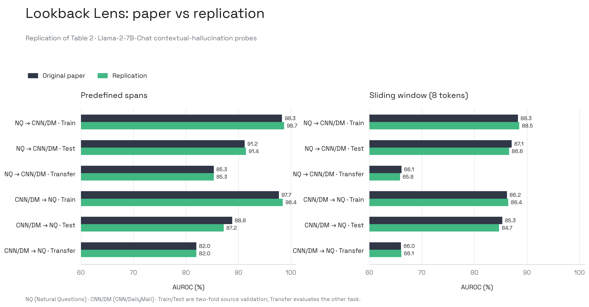
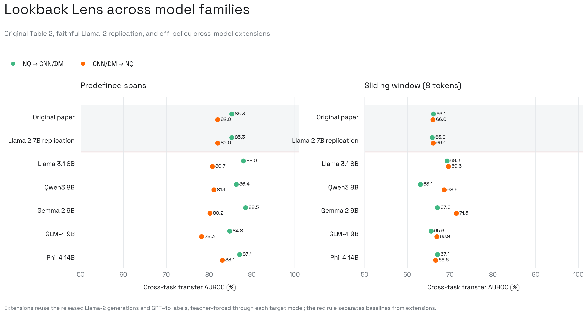

# Lookback Lens

The paper trains a logistic-regression probe to detect contextual
hallucinations from attention maps. For every generated span, it averages each
head's ratio of attention to the input context versus prior generated tokens,
then concatenates all heads and layers. The primary claim is that this compact
feature transfers across Natural Questions and CNN/DailyMail as well as richer
hidden-state and NLI detectors.

## Evaluation Protocol

| Item | Specification |
| :--- | :--- |
| Venue | EMNLP 2024 Main |
| Model | Llama-2-7B-Chat |
| Data | 2,655 Natural Questions; 1,000 CNN/DailyMail |
| Labels | GPT-4o span-level factuality annotations |
| Probe | Scikit-learn logistic regression, default L2, `max_iter=1000` |
| Features | Lookback ratios from all 32 layers and all 32 heads |
| Evaluation | Two-fold validation and cross-task AUROC |
| Primary target | Table 2, predefined spans and sliding window 8 |

## Release Audit

The official repository includes the full extraction and probing code, a
vendored Transformers 4.32.0 checkout, four trained 7B classifiers, source
datasets, and a linked archive containing the exact 7B lookback ratios and
GPT-4o annotations required for Table 2. The wrapper executes the authors'
`step03_lookback_lens.py` unchanged.

The release specifies Python 3.9.5, CUDA 11.7, PyTorch 2.0.0, and NumPy
1.26.2, but does not pin scikit-learn, SciPy, Accelerate, or the Llama model
revision. The linked archive does not contain the Llama-2-13B features,
NQ-train features, or head-mapping matrix needed for Table 4. We therefore
start with the fully released Table 2 baseline and keep cross-model transfer as
a separate second-stage audit. The local CPU run resolved Python 3.9.6, SciPy
1.13.1, and scikit-learn 1.6.1 while preserving the released PyTorch, NumPy,
and Transformers versions.

## Replication

The authors' unchanged probe script was run on the released features and
annotations. Across all 12 Table 2 cells, mean absolute AUROC deviation is
0.0041. Eleven cells are within 0.0075; the largest difference is the
CNN/DailyMail source-test score under predefined spans, which is 0.8720 versus
0.8880 in the paper.

| Setting | Direction | Split | Paper | Replication | Delta |
| :--- | :--- | :--- | ---: | ---: | ---: |
| Predefined | NQ → CNN/DM | Test | 0.912 | 0.914 | +0.002 |
| Predefined | NQ → CNN/DM | Transfer | 0.853 | 0.853 | +0.000 |
| Predefined | CNN/DM → NQ | Test | 0.888 | 0.872 | -0.016 |
| Predefined | CNN/DM → NQ | Transfer | 0.820 | 0.820 | +0.000 |
| Window 8 | NQ → CNN/DM | Test | 0.871 | 0.866 | -0.005 |
| Window 8 | NQ → CNN/DM | Transfer | 0.661 | 0.658 | -0.003 |
| Window 8 | CNN/DM → NQ | Test | 0.853 | 0.847 | -0.006 |
| Window 8 | CNN/DM → NQ | Transfer | 0.660 | 0.661 | +0.001 |

**Verdict:** Table 2 is successfully replicated. The cross-task generalization
claim is recovered, with all four transfer AUROCs within 0.003 of the paper.
This verdict does not yet cover the unreleased 7B-to-13B artifacts behind
Table 4.

## Cross-model Extension

The released Llama-2 generations and GPT-4o labels were held fixed and
teacher-forced through five instruction-tuned models. We recomputed every
layer/head lookback ratio and reran the authors' unchanged two-fold probe
evaluation. This isolates representation and probe transfer from differences
in generated answers.

| Model | Predefined NQ → CNN/DM | Predefined CNN/DM → NQ | Window 8 NQ → CNN/DM | Window 8 CNN/DM → NQ | Mean |
| :--- | ---: | ---: | ---: | ---: | ---: |
| Original paper | 0.853 | 0.820 | 0.661 | 0.660 | 0.749 |
| Llama-2-7B replication | 0.853 | 0.820 | 0.658 | 0.661 | 0.748 |
| Llama 3.1 8B | 0.880 | 0.807 | 0.693 | 0.696 | 0.769 |
| Qwen3 8B | 0.864 | 0.811 | 0.631 | 0.686 | 0.748 |
| Gemma 2 9B | 0.885 | 0.802 | 0.670 | 0.715 | 0.768 |
| GLM-4 9B | 0.848 | 0.783 | 0.656 | 0.669 | 0.739 |
| Phi-4 14B | 0.871 | 0.831 | 0.671 | 0.666 | 0.760 |

**Extension verdict:** Lookback Lens generalizes across all five tested model
families. Mean transfer AUROC ranges from 0.739 to 0.769 versus 0.748 for the
Llama-2 replication. The weakest individual shift is Qwen3 on windowed
NQ-to-CNN/DailyMail transfer (0.631 versus 0.658), which is a modest rather
than systematic cross-model failure.

