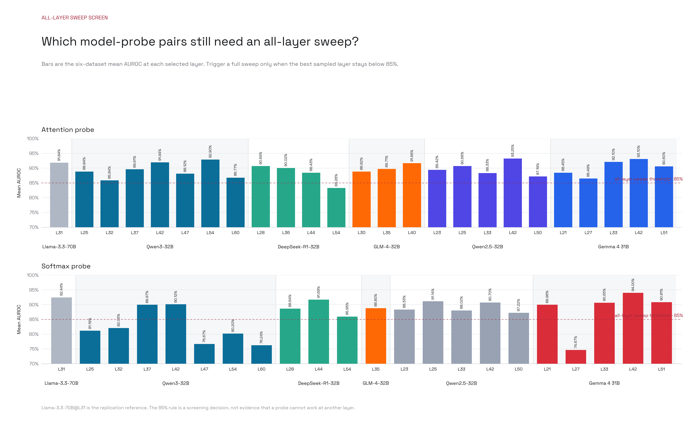

# Detecting High-Stakes Interactions With Activation Probes

[Paper](https://arxiv.org/abs/2506.10805)

The study evaluates whether activation probes distinguish high-stakes from low-stakes interactions. The replication recovers the selected Llama-3.3-70B attention-probe result. Extensions recover predictive signals in additional model families, with substantial variation across layers and probe architectures. These experiments assess probes fitted separately to each model.

## Data And Measurement

The training corpus contains 8,000 synthetic examples generated and labelled by GPT-4o, with 2,000 held-out synthetic examples. Evaluation uses six filtered and balanced datasets containing 6,190 examples. These include human-written material and third-party model outputs, including synthetic ToolACE conversations. They are not responses generated by the model being probed.

| Evaluation dataset | Test examples |
| :--- | ---: |
| Anthropic HH-RLHF | 2,984 |
| ToolACE | 734 |
| MT Samples | 604 |
| MTS Dialog | 86 |
| Mental Health | 540 |
| Aya Redteaming | 1,242 |

The released datasets have been relabelled, filtered and balanced. The Aya artifact differs from the paper's stated 1,513 test examples. Unseeded sampling in the balancing procedure also limits exact regeneration. The generator's initial stakes flag and final labels disagree on approximately 4–5% of training rows.

The paper describes residual activations before layer normalization, while the released hook captures its output. The replication therefore distinguishes pre-normalization and post-normalization extraction. The Llama baseline below uses the paper-described pre-normalization site at layer 31.

## Baseline Replication

| Probe | Published comparison | Replication | Scope |
| :--- | :--- | :--- | :--- |
| Attention | Approximately 0.917 AUROC over six datasets | 0.9184 mean over three seeds | Selected aggregate recovered |
| Softmax | Approximately 0.948 AUROC over four datasets | 0.9244 over six datasets, seed 0 | Different aggregation prevents a direct fidelity verdict |

The attention seed means are 0.9180, 0.9182 and 0.9190. Dataset-level results for seed 0 are reported below.

| Dataset | Attention AUROC | Softmax AUROC |
| :--- | ---: | ---: |
| Anthropic HH-RLHF | 0.9495 | 0.9651 |
| ToolACE | 0.8747 | 0.8352 |
| MT Samples | 0.9834 | 0.9906 |
| MTS Dialog | 0.9924 | 0.9808 |
| Mental Health | 0.8068 | 0.8515 |
| Aya Redteaming | 0.9011 | 0.9234 |
| Macro mean | 0.9180 | 0.9244 |

Ranking performance does not establish useful performance at a fixed threshold. At threshold 0.5, the softmax probe's ToolACE recall is 0.0381. On Mental Health, its accuracy is 0.5 and MCC is 0.0 despite recall of 0.9741. Low-FPR estimates also require attention to sample size. MTS Dialog contains 43 negatives, so one additional false positive changes empirical FPR by approximately 2.33 percentage points.

## Exploratory Model Comparisons

The following maxima were identified by inspecting test performance over sampled layers. They are diagnostic results, not estimates of a layer-selection rule chosen independently of the test data.

| Model | Probe | Best sampled layer | Macro AUROC |
| :--- | :--- | ---: | ---: |
| Qwen2.5-32B-Instruct | Attention | 42 | 0.9325 |
| Qwen2.5-32B-Instruct | Softmax | 25 | 0.9114 |
| Gemma-4-31B-IT | Attention | 42 | 0.9310 |
| Gemma-4-31B-IT | Softmax | 42 | 0.9400 |
| Qwen3-32B | Attention | 54 | 0.9290 |
| Qwen3-32B | Softmax | 42 | 0.9012 |
| DeepSeek-R1-Distill-Qwen-32B | Attention | 28 | 0.9069 |
| DeepSeek-R1-Distill-Qwen-32B | Softmax | 44 | 0.9169 |
| GLM-4-32B | Attention | 40 | 0.9166 |
| GLM-4-32B | Softmax | 35 | 0.8880 |

Qwen3 attention AUROC was 0.8584 at layer 32 and 0.8812 at layer 47 before the expanded screen identified layer 54. Softmax AUROC was 0.8206 and 0.7667 at those initial layers. The expanded screen therefore changes the interpretation of the initial low scores: they do not establish a model-wide absence of a decodable signal.

DeepSeek also exhibits a layer-dependent probe ranking. Attention AUROC declines from 0.9069 at layer 28 to 0.8326 at layer 54, while softmax reaches 0.9169 at layer 44. GLM attention improves from 0.8882 at layer 30 to 0.9166 at layer 40. Model comparisons use unequal sampled layer grids and limited fitting repetitions, so architecture-specific causal conclusions are not supported.

## Recorded OLMo 2 Selection Analysis

The saved OLMo-2-0325-32B-Instruct analysis compares relative-depth selection, development-based selection and a test-selected diagnostic. Its activation adapter uses the decoder-block input as the structural analogue of the original pre-normalization site.

| Probe | Relative-depth layer 25 | Development-selected layer 38 | Best test-layer diagnostic |
| :--- | ---: | ---: | ---: |
| Attention | 0.8687 | 0.8911 | 0.9066 at layer 46 |
| Softmax | 0.8690 | 0.9045 | 0.9045 at layer 38 |

Values are test macro AUROC. The three recorded seed entries have identical aggregate scores, so their zero dispersion does not establish robustness to independent refitting. Development data cover four datasets, while the test macro average covers six. This difference in coverage and the architecture-specific activation adapter constrain comparison with the original Llama result.

## Interpretation

The evidence supports target-model decodability under multiple model families. It also shows that layer choice, activation definition, dataset aggregation and operating threshold materially affect measured performance. The exploratory maxima cannot establish that a selection or calibration procedure transfers. Such claims require development-only selection, matched search budgets, sufficient independent fits and threshold evaluation on held-out examples.
