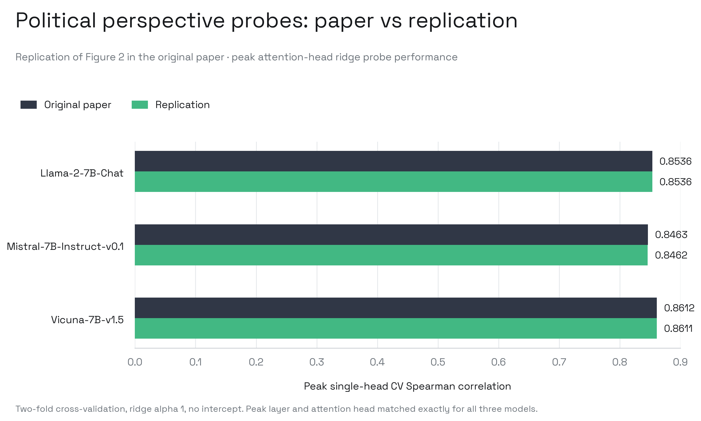
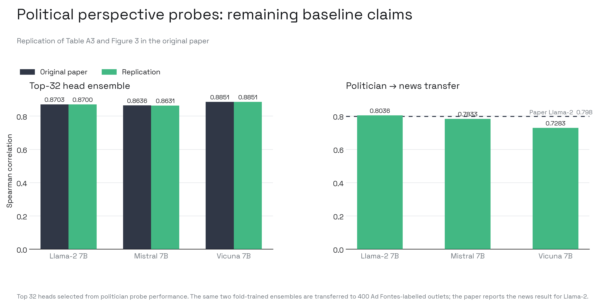
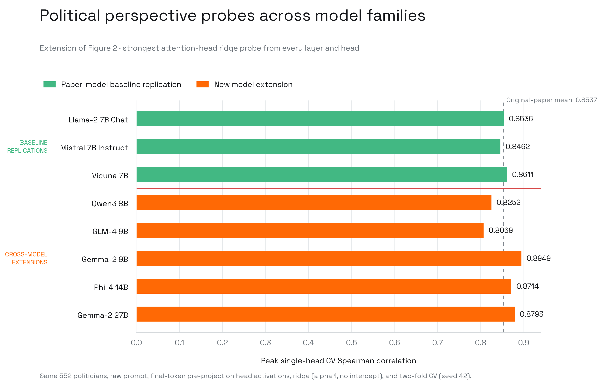

# Linear Representations of Political Perspective Emerge in LLMs

See also: [Generalization analysis](generalization.md) — taxonomy of why this method transfers unevenly.

The paper asks whether American liberal–conservative perspective is encoded as
a linear direction inside LLM attention heads. It fits ridge regressions from
the final prompt-token activation of every head to DW-NOMINATE scores for 552
members of the 116th U.S. Congress. The strongest middle-layer heads reach
Spearman correlations of 0.846–0.861 across three 7B chat/instruction models;
top-head ensembles transfer to independently labelled news outlets, and the
learned directions are also used for steering.

## Baseline contract

| Item | Released specification |
| :--- | :--- |
| Venue | ICLR 2025 |
| Models | Llama-2-7B-Chat; Mistral-7B-Instruct-v0.1; Vicuna-7B-v1.5 |
| Probe input | Pre-layer-normalization attention-head output at the final prompt token |
| Probe | Ridge regression, no intercept |
| Label | DW-NOMINATE dimension 1, from -1 liberal to +1 conservative |
| Data | 552 lawmakers; transfer to 400 Ad Fontes-labelled news outlets |
| Evaluation | Two-fold CV; mean Spearman correlation; seed 42 |
| Regularization | `lambda=1`, selected from seven values |
| Primary targets | Figure 2; Table A3; Figure 3 |

## Initial audit

The official repository and OSF release contain the notebooks, custom Llama
attention hook, both source datasets, all three models' politician/news
activations, probe-performance matrices, ridge checkpoints, and intervention
tables. This is sufficient for a released-artifact diagnostic and an
independent baseline rerun.

The release is not directly executable: the main notebook contains an invalid
Hugging Face token assignment, has no executable script or requirements file,
omits the scikit-learn version, and pins no model revisions. The approved
wrapper replaces only the token assignment in a hashed artifact copy and
executes the released probing cells unchanged. The upstream source remains
untouched. The notebook's unpinned `baukit` install also resolves torchvision;
we pair `torchvision==0.18.0` with the released PyTorch 2.3.0 to prevent current
torchvision releases from silently replacing the paper runtime.
The first independent launch further exposed an incompatible combination from
the notebook's unpinned `accelerate` install and `pyvene`'s exact Hub pin. The
reconstruction therefore uses `accelerate==0.27.2` with
`huggingface-hub==0.20.3`; this remains an environment specification gap.

## Released-artifact diagnostic

The three released performance matrices reproduce the paper's peak
single-head values and locations exactly to the reported precision. This
validates the OSF artifacts and plotting inputs; it is not an independent
replication.

| Model | Paper | Released artifact | Layer | Head |
| :--- | ---: | ---: | ---: | ---: |
| Llama-2-7B-Chat | 0.8536 | 0.853597 | 15 | 18 |
| Mistral-7B-Instruct-v0.1 | 0.8463 | 0.846261 | 16 | 3 |
| Vicuna-7B-v1.5 | 0.8612 | 0.861170 | 24 | 8 |

## Replication status

The released notebook independently reproduces the Figure 2 peak single-head
probe correlations and the exact peak layer/head locations.

| Model | Paper | Replication | Delta | Peak |
| :--- | ---: | ---: | ---: | :--- |
| Llama-2-7B-Chat | 0.8536 | 0.853613 | +0.000013 | L15 H18 |
| Mistral-7B-Instruct-v0.1 | 0.8463 | 0.846168 | -0.000132 | L16 H3 |
| Vicuna-7B-v1.5 | 0.8612 | 0.861087 | -0.000113 | L24 H8 |

The separate released figure notebook also reproduces the top-32 ensemble and
politician-to-news transfer from the independently extracted activations.

| Target | Model | Paper | Replication | Delta |
| :--- | :--- | ---: | ---: | ---: |
| Table A3, top-32 ensemble | Llama-2-7B-Chat | 0.8703 | 0.8700 | -0.0003 |
| Table A3, top-32 ensemble | Mistral-7B-Instruct-v0.1 | 0.8636 | 0.8631 | -0.0005 |
| Table A3, top-32 ensemble | Vicuna-7B-v1.5 | 0.8851 | 0.8851 | -0.0000 |
| Figure 3, news transfer | Llama-2-7B-Chat | 0.7980 | 0.8036 | +0.0056 |

The same news-transfer evaluation gives 0.7833 for Mistral and 0.7283 for
Vicuna; the paper does not report comparator values for these two models.

**Verdict:** the probe-focused baseline is successfully replicated. Figure 2,
Table A3, and Figure 3 all recover the reported results. Figure 4 is a steering
experiment and is outside the probe-only scope.

## Cross-model extension

The extension preserves the 552 politicians, raw prompt, final-token
pre-projection head activations, ridge configuration, and two-fold split. It
fits a separate probe for every attention head in every layer.

| Model | Parameters | Probes | Peak Spearman | Peak |
| :--- | ---: | ---: | ---: | :--- |
| Qwen3-8B | 8.2B | 1,152 | 0.8252 | L17 H8 |
| GLM-4-9B-0414 | 9B | 1,280 | 0.8069 | L22 H24 |
| Gemma-2-9B-it | 9B | 672 | 0.8949 | L33 H10 |
| Phi-4 | 14B | 1,600 | 0.8714 | L19 H29 |
| Gemma-2-27B-it | 27B | 1,472 | 0.8793 | L15 H12 |

**Extension verdict:** the representation transfers unevenly rather than
failing universally. Gemma and Phi match or exceed the paper-model range,
whereas Qwen and GLM fall by approximately 0.029 and 0.047 relative to the
original-paper mean. Within Gemma, scaling from 9B to 27B does not improve the
peak result.

