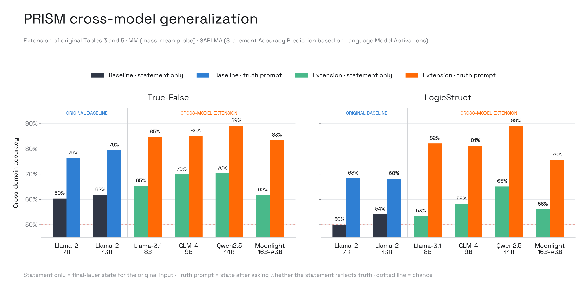

# PRISM Replication Report

PRISM studies whether explicitly asking an LLM to assess a statement’s truth
makes its internal truth signal easier to detect across domains. Its main claim
is that prompt-guided states substantially improve the cross-domain accuracy of
existing hallucination probes. The authors extract the final-layer,
last-token state from either a bare statement or the prompt “Does the statement
… accurately reflect the truth?”, then apply MM—a difference-of-class-means
linear direction—and SAPLMA—a four-layer MLP classifier. We reproduced the
complete Llama-2-7B/13B baseline closely. More importantly, the prompt-guided
gain held for Llama-3.1, GLM-4, Qwen2.5, and Moonlight, supporting the paper’s
central claim across every tested extension family.

## Summary

## Replication status

The complete Llama-2-7B/13B baseline is reproduced. All 88 paper-target cells
are complete. The official code and raw data are pinned at `b0953654`; paper
targets remain frozen in `data/results/prism/baseline_targets.csv`.

The release contains no activations, checkpoints, or result artifacts. It also
hardcodes Llama-2-7B and output paths in generation scripts. For 13B, our
wrapper enables the release-provided commented model/path switches inside a
verified artifact worktree. The pinned checkout remains unchanged.

## Baseline results

| Model | Dataset | Probe | State | Paper | Replication | Delta |
| :--- | :--- | :--- | :--- | ---: | ---: | ---: |
| Llama-2-7B | True-False | MM | raw | 0.5572 | 0.5572 | -0.0000 |
| Llama-2-7B | True-False | SAPLMA | raw | 0.6563 | 0.6500 | -0.0063 |
| Llama-2-7B | True-False | MM | prompted | 0.7524 | 0.7524 | +0.0000 |
| Llama-2-7B | True-False | SAPLMA | prompted | 0.7735 | 0.7746 | +0.0011 |
| Llama-2-7B | LogicStruct | MM | raw | 0.4966 | 0.4966 | +0.0000 |
| Llama-2-7B | LogicStruct | SAPLMA | raw | 0.5030 | 0.5036 | +0.0006 |
| Llama-2-7B | LogicStruct | MM | prompted | 0.6405 | 0.6405 | -0.0000 |
| Llama-2-7B | LogicStruct | SAPLMA | prompted | 0.6734 | 0.7265 | +0.0531 |
| Llama-2-13B | True-False | MM | raw | 0.5457 | 0.5457 | -0.0000 |
| Llama-2-13B | True-False | SAPLMA | raw | 0.6858 | 0.6900 | +0.0042 |
| Llama-2-13B | True-False | MM | prompted | 0.7889 | 0.7889 | +0.0000 |
| Llama-2-13B | True-False | SAPLMA | prompted | 0.7987 | 0.7994 | +0.0007 |
| Llama-2-13B | LogicStruct | MM | raw | 0.4995 | 0.4995 | +0.0000 |
| Llama-2-13B | LogicStruct | SAPLMA | raw | 0.5710 | 0.5824 | +0.0114 |
| Llama-2-13B | LogicStruct | MM | prompted | 0.6734 | 0.6734 | -0.0000 |
| Llama-2-13B | LogicStruct | SAPLMA | prompted | 0.7074 | 0.6907 | -0.0167 |

Prompting improves every model-dataset-probe pair, reproducing the paper's
central result. Thirteen of sixteen aggregate cells are within 0.0064 accuracy
of the paper. The largest difference remains 7B prompted LogicStruct SAPLMA
at +0.0531.

## Cross-model extension

The released probes were extended to four instruction-tuned model families.
Prompt guidance improves all 16 model-dataset-probe comparisons.

| Model | Dataset | PRISM–MM | PRISM–SAPLMA | Mean gain over raw |
| :--- | :--- | ---: | ---: | ---: |
| Llama-3.1-8B | True-False | 0.8627 | 0.8306 | +0.1934 |
| Llama-3.1-8B | LogicStruct | 0.7854 | 0.8569 | +0.2874 |
| GLM-4-9B | True-False | 0.8652 | 0.8365 | +0.1521 |
| GLM-4-9B | LogicStruct | 0.8304 | 0.7944 | +0.2304 |
| Qwen2.5-14B | True-False | 0.8930 | 0.8891 | +0.1880 |
| Qwen2.5-14B | LogicStruct | 0.8763 | 0.9050 | +0.2396 |
| Moonlight-16B-A3B | True-False | 0.8267 | 0.8405 | +0.2165 |
| Moonlight-16B-A3B | LogicStruct | 0.7378 | 0.7731 | +0.1949 |

## Configuration blockers

| Item | Release state |
| :--- | :--- |
| Llama-2 access | Approved; 7B and 13B downloads verified |
| `accelerate` | Missing from release; wrapper adds Transformers 4.33.2 minimum `0.20.3` |
| `sentencepiece` | Missing from release; wrapper adds release-era `0.1.99` |
| `protobuf` | Missing from release; wrapper adds release-era `4.24.3` |
| Model revision | Not pinned |
| Llama-2-13B | Release-provided switches enabled in a verified artifact worktree |
| LogicStruct seeds | Paper specifies three seeds; no seed driver is released |

## Artifacts

- Plotting-ready full table: `data/results/prism/mega_table.csv`
- Aggregate table: `data/results/prism/baseline_summary.csv`
- Extension aggregates: `data/results/prism/extension_summary.csv`
- Cross-model aggregates: `data/results/prism/cross_model_summary.csv`
- Run log: `runs/prism/llama2-7b-a100-45916575.log` in the public artifact bucket
