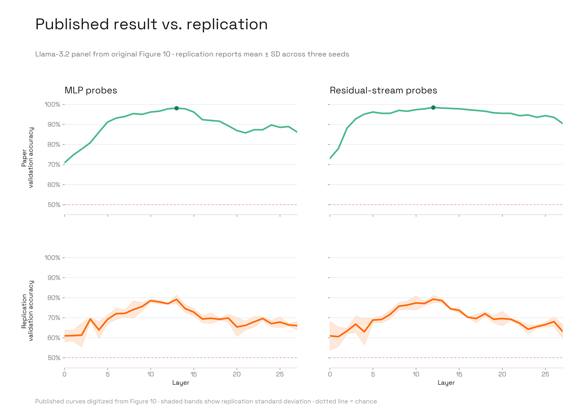

# Sycophancy Hides Linearly In The Attention Heads

The paper localizes correct-to-incorrect sycophancy with linear probes trained
on MHA-head, MLP, and residual-stream activations. We tested its released
Llama-3.2-3B-Instruct probe-localization baseline using the paper's optimizer
settings and three seeds. The middle-layer pattern reappeared, but the reported
probe accuracy did not.

## Baseline Verdict

**Not reproduced.** Both Figure 10 peak accuracies are approximately 19
percentage points below the paper.

| Model | Component | Paper peak | Replication peak | Delta | Peak layer |
| :--- | :--- | ---: | ---: | ---: | :--- |
| Llama-3.2-3B-Instruct | MLP | 98.09% | 79.13% ± 2.17% | -18.96 pp | 13 → 13 |
| Llama-3.2-3B-Instruct | Residual stream | 98.47% | 79.26% ± 1.88% | -19.21 pp | 12 → 12 |

The localization trend replicated qualitatively: both components peak in the
middle layers. The paper's performance magnitude did not replicate, so we do
not treat the released baseline as recovered and stop before cross-model
extensions.

The failure is best classified as an **in-domain learning mismatch**, with
**missing reference artifacts** limiting diagnosis. The release provides no
paper checkpoints, activations, result dictionaries, or exact per-seed values
for comparison.

