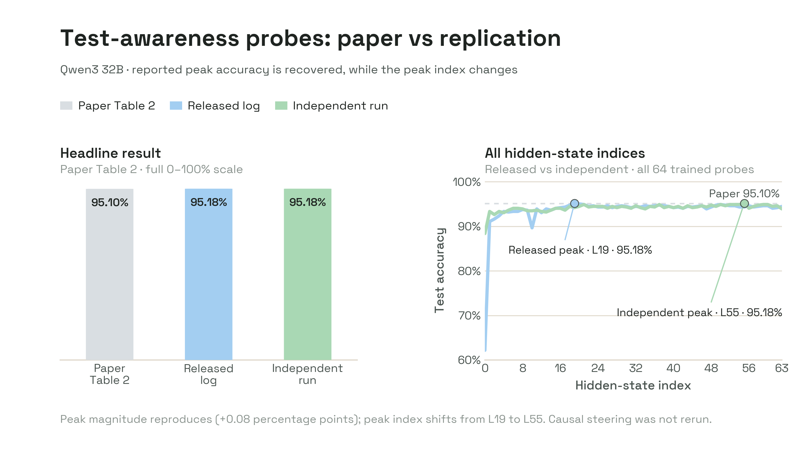

# The Hawthorne Effect In Reasoning Models

[Paper](https://proceedings.neurips.cc/paper_files/paper/2025/hash/cf42f133f355e0e07a8957b508b26a1b-Abstract-Conference.html) · NeurIPS 2025 · [Released code](https://github.com/microsoft/Test_Awareness_Steering)

The paper asks whether reasoning models internally represent that they are being evaluated. It creates paired real and hypothetical harmful requests, generates on-policy reasoning traces, labels explicit evidence of evaluation awareness with an LLM judge, and averages hidden states over the labeled evidence spans. A separate affine softmax probe is trained at every layer. The paper reports best-layer accuracies of 95.4% for QwQ-32B, 95.1% for Qwen3-32B, and 92.7% for DeepSeek-R1-Distill-Qwen-32B, then uses the probe directions for causal steering.

## Release Audit

The three reported white-box baselines use 32B Qwen-family architectures. The release includes the trigger data, generated model answers, judge labels and evidence spans, 64 probe checkpoints per model, train/test subsets, training logs, and exact dependency versions. Its released log peaks agree with Table 2 within 0.09 percentage points, but this is artifact validation rather than an independent rerun.

The paper specifies SGD with learning rate 0.008, momentum 0.9, and up to 300 epochs; the released trainer omits momentum, and the released QwQ log records 100 rather than 300 epochs. The prepared wrapper uses the paper values without editing the author checkout and records the mismatch. Model inference uses bfloat16 to fit one H200, then casts extracted representations to float32 before probe training; this is a declared runtime deviation from the release's implicit float32 load.

## Qwen3 Baseline Replication

We reran the Qwen3-32B Table 2 probing path from the pinned author release. The run reused the released model responses, judge labels, evidence spans, and deterministic prompt split, then independently re-extracted all 64 hidden-state indices and retrained one affine softmax probe per index. We used the paper hyperparameters: SGD, learning rate 0.008, momentum 0.9, and 300 epochs. Hidden states were extracted in bfloat16 to fit one H200 and cast to float32 before probe training.

| Evidence | Peak accuracy | Peak index | Difference from paper |
| --- | ---: | ---: | ---: |
| Paper Table 2 | 95.10% | Not reported | — |
| Released training log | 95.184% | 19 | +0.084 pp |
| Independent replication | 95.184% | 55 | +0.084 pp |

The independent peak has balanced accuracy 95.13%, precision 93.52%, recall 94.81%, F1 94.16%, and TN/FP/FN/TP = 398/19/15/274. Its AUROC is 95.69%; the highest AUROC across the sweep is 98.58% at index 9. The classifier evaluates 706 evidence-span representations derived from 374 balanced test prompts, because one prompt can contribute several annotated spans; the resulting classifier rows contain 289 positive and 417 negative spans.

The peak magnitude is stable, but its location is not. The released and independent curves are within 0.5 percentage points at 47 of 64 indices and within one point at 61 of 64. Excluding index 0, their mean absolute difference is 0.40 points. The released log peaks at index 19, whereas the independent run peaks at index 55; 40 independent indices nevertheless lie within one point of the maximum. The comparison should not be read as a causal diagnosis: the paper-faithful rerun adds the momentum omitted by the released trainer, uses a pinned model revision and bfloat16 inference, and contains one probe-training run per index. Under the authors' indexing, index 0 is the embedding output rather than a transformer block.

## Verdict

The Qwen3 Table 2 probe accuracy was successfully reproduced to the paper's reported precision. This is a selected-model baseline replication, not a full-paper replication: QwQ, Distill-Qwen, response generation, judge annotation, and causal steering were not rerun. The result supports the reported probe magnitude while showing that the accuracy-selected peak index is not stable across runs.
